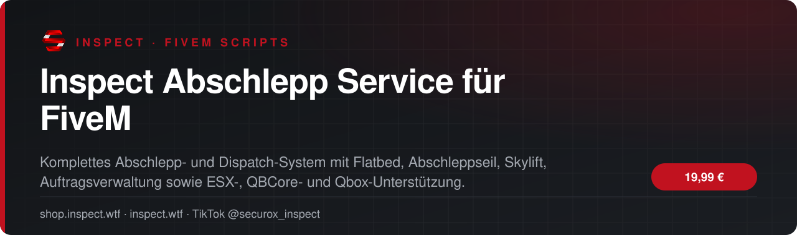
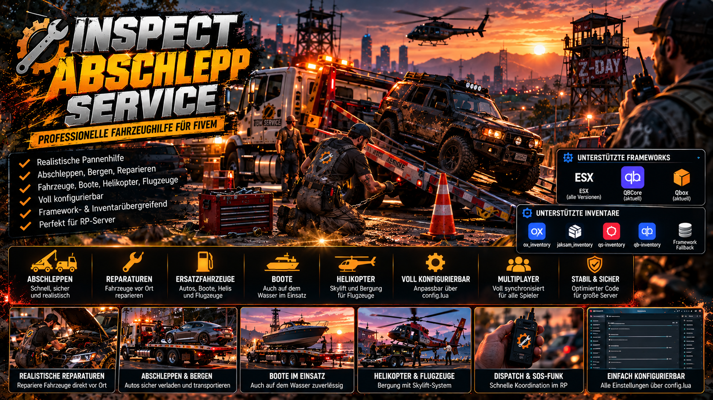
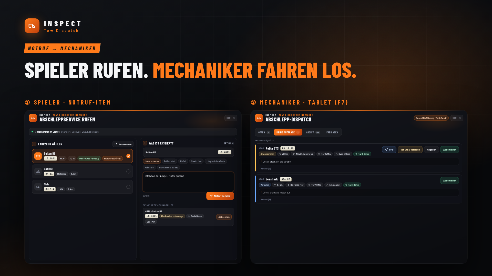
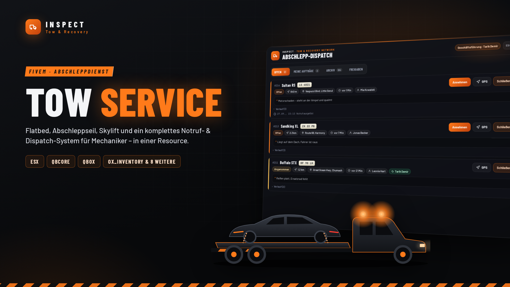
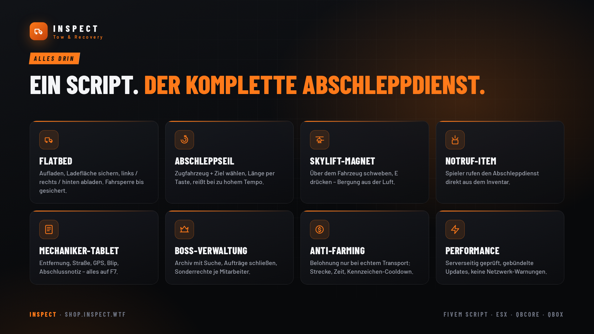
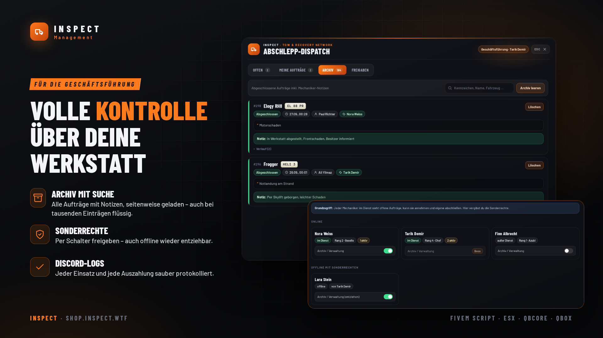

<!-- inspect-showcase: automatisch erzeugt, Änderungen bitte im Shop vornehmen -->

  
  
  
  
  

  
  
  

 

> 🇬🇧 **English:** Inspect Abschlepp Service für FiveM – FiveM script (ESX, QBCore, Qbox) by SecuroX Inspect. Purchase and licensing exclusively at [shop.inspect.wtf](https://shop.inspect.wtf). Product details below are in German – questions are welcome on [Discord](https://discord.gg/inspect).

 

## Das Wichtigste auf einen Blick

<table>
  <tr>
    <td width="50%" valign="top">✔&nbsp; <b>Automatische Framework-Erkennung: ESX Legacy, QBCore und Qbox</b></td>
    <td width="50%" valign="top">✔&nbsp; <b>Automatische Inventar-Erkennung: ox_inventory, jaksam_inventory, qs-inventory und qb-inventory</b></td>
  </tr>
  <tr>
    <td width="50%" valign="top">✔&nbsp; <b>Manuelle Framework-/Inventar-Auswahl als Fallback in der config.lua</b></td>
    <td width="50%" valign="top">✔&nbsp; <b>Flatbed-System zum sicheren Auf- und Abladen von Fahrzeugen</b></td>
  </tr>
</table>

## Überblick

Der Inspect Abschlepp Service ist ein umfangreiches Abschlepp- und Pannenhilfe-System für FiveM. Mechaniker können Fahrzeuge realistisch auf Flatbeds verladen, per Abschleppseil ziehen oder mit dem Skylift transportieren. Zusätzlich steht ein vollständiges Dispatch-System zur Verfügung: Spieler können Abschlepp-Notrufe senden, Mechaniker Aufträge annehmen, GPS-Routen setzen, Fahrzeuge als verladen markieren und Aufträge mit Abschlussnotiz archivieren. Die Verkaufsfassung erkennt ESX Legacy, QBCore oder Qbox automatisch und unterstützt ox_inventory, jaksam_inventory, qs-inventory und qb-inventory sowie Framework-Inventare. Die ursprüngliche Server-Synchronisation, Anti-Farming-Logik, Job- und Berechtigungsprüfung, JSON-Persistenz und Fahrzeugtransport-Logik bleiben erhalten. Die Z-Day-Garagenintegration ist optional: Das eigentliche Abschleppsystem funktioniert ohne zday_garages; bei vorhandener Integration kann das Dispatch-Board zusätzlich persistente ausgeparkte Fahrzeuge anzeigen.

## Kompatibilität

| | |
|:--|:--|
| Frameworks | **ESX** · **QBCore** · **Qbox** |
| Unterstützte Ressourcen | `ox_inventory` · `ox_target` · `qb-target` |
| Plattform | FiveM (GTA V) |

## Alle weiteren Funktionen

- Serverseitige Truck- und Kennzeichen-Locks gegen Doppelbenutzung
- Stabilisierung geladener Fahrzeuge gegen Rutschen, Fallen und Desync
- Konfigurierbare Flatbed-Modelle, Attach-Offets und Presets
- Realistisches Abschleppseil als Item mit dynamischer Seillänge
- Abschleppseil mit Geschwindigkeits- und Distanzschutz
- Skylift-Magnet für Fahrzeugtransporte per Helikopter
- Unterstützung für ox_target und qb-target mit Fallback-Interaktionen
- Komplettes Abschlepp-Dispatch-System mit eigener NUI
- Spieler können Fahrzeuge in der Nähe auswählen und Abschlepp-Notrufe senden
- Mechaniker-Dashboard mit offenen, eigenen und abgeschlossenen Aufträgen

<b>15 weitere Funktionen anzeigen</b>

- GPS-/Blip-System für angenommene Abschlepp-Aufträge
- Auftragsstatus: offen, angenommen, verladen und abgeschlossen
- Abschlussnotizen und Verlauf pro Auftrag
- Boss- und Sonderberechtigungen für Dispatch-Funktionen
- Persistente JSON-Speicherung für Dispatches und Berechtigungen
- Seitengeladenes Archiv zur Reduzierung von Netzwerktraffic
- Cooldowns, Throttling und Anti-Spam für wichtige Netzwerkaktionen
- Anti-Farming-Auszahlung mit Mindestdistanz, Mindestzeit und Kennzeichen-Cooldown
- Konfigurierbare Belohnung und Geldkonto
- Frameworkübergreifende Job-, Geld-, Spieler- und Admin-Bridge
- Optionale zday_garages-Integration für persistente ausgeparkte Fahrzeuge
- Discord-Webhook-Unterstützung über serverseitige Config
- ACE-Admin-Fallback für frameworkübergreifende Administration
- Installationsanleitung und ox_inventory Item-Beispiele enthalten
- Zentrale Konfiguration für Jobs, Fahrzeuge, Dispatch, Seil, Skylift und Belohnungen

## Einblicke

<table>
  <tr>
    <td width="50%"></td>
    <td width="50%"></td>
  </tr>
  <tr>
    <td width="50%"></td>
    <td width="50%"></td>
  </tr>
  <tr>
    <td width="50%"></td>
    <td width="50%"></td>
  </tr>
</table>

## Preis

**19,99 €** &nbsp;–&nbsp; einmaliger Kaufpreis · Download und Lizenz im Kundenkonto

Sichere Zahlung mit PayPal oder Kreditkarte · Rechnung als PDF · Support auf Deutsch

## So einfach geht's

1. **Im Shop kaufen** – sicher bezahlen mit PayPal oder Kreditkarte.
2. **Sofort loslegen** – Download und Lizenz stehen direkt nach Zahlungseingang in deinem Kundenkonto bereit, die Rechnung erhältst du als PDF.
3. **Einrichten** – bei Fragen hilft dir unser Support im Discord weiter.

## Warum INSPECT?

<table>
  <tr>
    <td width="50%" valign="top"><b>🇩🇪 Entwickelt in Deutschland</b> Konzeption, Entwicklung und Support aus einer Hand.</td>
    <td width="50%" valign="top"><b>💬 Persönlicher Support</b> Schnelle Hilfe auf Deutsch im INSPECT Discord.</td>
  </tr>
  <tr>
    <td width="50%" valign="top"><b>🔒 Sichere Zahlung</b> PayPal oder Kreditkarte, Rechnung automatisch als PDF.</td>
    <td width="50%" valign="top"><b>⚡ Sofort verfügbar</b> Download und Lizenz direkt nach der Zahlung im Kundenkonto.</td>
  </tr>
</table>

## Häufige Fragen

<b>Wie erhalte ich das Produkt?</b>

 

Nach bestätigter Zahlung stehen Download und Lizenz in deinem Kundenkonto bereit. Die Rechnung erhältst du als PDF.

<b>Welche Frameworks werden unterstützt?</b>

 

ESX, QBCore, Qbox – zusätzlich mit Unterstützung für ox_inventory, ox_target, qb-target.

<b>Bekomme ich Hilfe bei der Einrichtung?</b>

 

Ja – unser Support hilft dir im [INSPECT Discord](https://discord.gg/inspect) persönlich und auf Deutsch.

<b>Wo kaufe ich offiziell?</b>

 

Ausschließlich im INSPECT Shop unter [shop.inspect.wtf](https://shop.inspect.wtf). Angebote von Dritten stammen nicht von uns.

## Kontakt

| | |
|:--|:--|
| 🛒 Shop | [shop.inspect.wtf](https://shop.inspect.wtf) |
| 🌐 Website | [inspect.wtf](https://inspect.wtf) |
| 💬 Discord | [discord.gg/inspect](https://discord.gg/inspect) |
| 🎬 TikTok | [@securox_inspect](https://www.tiktok.com/@securox_inspect) |
| ✉️ E-Mail | [info@inspect.wtf](mailto:info@inspect.wtf) |

---

<b>SecuroX Inspect</b> · Offizielle Produktpräsentation · Dieses Repository enthält keinen Quellcode und keine Produktdateien. 
Kauf und Lizenzen ausschließlich über <a href="https://shop.inspect.wtf">shop.inspect.wtf</a> · Inhalte werden automatisch aus dem Shop aktualisiert.

